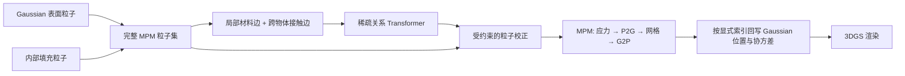

# PhysGaussian + 关系 Transformer：实施规格

## 方法定义

默认仿真训练入口现已采用官方 PhysCoRe 的 MfM/RfD 流程，直接复用其可微 MPM 与网格修正网络，在 G2P 前修正网格速度，通过位置重建损失反传并持续携带 x/v/F/C。已有真实物性的 jelly 使用明确标注的 known-material RfD 适配；完整 MfM/RfD 由官方入口处理对应数据。具体命令和兼容范围见 `INFERENCE.md`。

本文件下文保留历史关系网络方案。`--pipeline post-step` 仍可显式运行此前的**仿真后速度残差**：每个样本从真实完整状态计算 `v_true_next-v_base`，`PostStepRelationMPM` 在 G2P 后施加 `v=v_base+delta_v`、`x=x_base+dt*delta_v`，而 C/F 保留 baseline。这也是现有 Gaussian 渲染入口的旧 checkpoint 约定，不能加载 PhysCoRe RfD 权重。

下文的早期成对力/事件缓存设计保留为历史方案；它由旧 `RelationMPM` 实现，不是当前仿真后速度残差的监督或 checkpoint 约定。实际训练、推理接口以 `INFERENCE.md` 和 `train_relation_full.py` 为准。材料先验分支仍在初始化时设置物性，与速度校正分开。

以 PhysGaussian 的 Warp MPM 为物理主干。所有参与仿真的表面 Gaussian 粒子和内部填充粒子组成完整集合 `P={p_i}_{i=1}^N`；关系 Transformer 在每个 MPM 子步的物理更新早期读取这个完整集合，并以材料内局部邻域、异材料界面和跨物体近接触关系调制粒子运动。MPM 随后完成应力、P2G、网格更新和 G2P；最后仅把具有渲染对应关系的粒子状态投影回 Gaussian。网络不读取仅供渲染的 `gs_num` 前缀作为其全部输入。

## 现有接口与必须补齐的数据

- `gs_simulation.py` 在过滤、坐标变换后把表面粒子放在数组前缀，可选 `fill_particles` 追加内部粒子；`mpm_init_pos` 全量进入 `load_initial_data_from_torch`。`sim_area` 外的 Gaussian 不进入 MPM，只作为静态背景渲染。若实验声称建模全部物质点，实验配置必须包含所有需要运动和接触的物体。
- `MPM_Simulator_WARP.p2g2p` 的顺序是可选关系校正、粒子边界操作、应力计算、P2G、网格更新、G2P。关系校正位于应力/P2G 之前，才会影响当前子步；帧末回写不构成早期物理建模。`gs_simulation.py` 在每个子步调用它。
- `gs_simulation.py` 原来用 `[:gs_num]` 投影可渲染粒子，现改成显式 `render_particle_indices`（现有场景仍是同样的前缀），导出 `x`、由形变得到的 `cov` 和 `R`，逆变换后送入 rasterizer；SH 和 opacity 保持原值。新场景需在过滤、填充与导出时保持索引和对应关系。
- 每个 MPM 粒子必须有稳定的 `object_id` 和 `material_id`。填充粒子继承其所在物体/材料体积标签，不能默认把它们当成同一个物体。标签在初始建图、模拟导出和训练轨迹中保持一致。
- 现有配置只有一个全局本构 `material`，但 `E`、`nu`、`density`、`mu`、`lam` 已是逐粒子数组。首轮可固定一种本构模型、让材料标签表示参数区域。若研究问题要求弹性/沙/流体等本构同时存在于同一场景，还必须把本构类型改成逐粒子并修改 `compute_stress_from_F_trial` 的分支；不能只给网络增加 `material_id` 就声称 MPM 支持混合本构。

## 关系与输出

粒子 token 使用 MPM 坐标下的 `x_i, v_i, F_i, C_i, mass_i, density_i, E_i, nu_i`，加对象和材料嵌入；可加时间与边界条件标记。位置使用相对坐标或局部尺度归一化，避免网络学习某个场景的绝对坐标。隐藏填充粒子与表面粒子一视同仁。

对每个粒子建立半径或定额近邻，区分同物体同材料、同物体异材料、跨物体近接触三类边。边特征至少含相对位移、距离、相对速度、对象关系和材料关系。跨物体边只在几何近邻或接触候选中建立；对象级汇聚 token 可提供全局条件，但不能替代粒子界面的接触边。用稀疏 attention 覆盖全部 `N` 个粒子；全局 `N×N` attention 不适合内部填充后的大粒子集。

最小耦合输出为关系力 `f_i` 或等价速度增量 `Δv_i=dt·f_i/m_i`，写回完整粒子的 Warp `particle_v`，再运行原 MPM 子步。优先由每条跨物体边预测反对称力 `f_ij=-f_ji`，使内部交互不凭空改变总动量；同物体材料边可预测对称的应力校正，在原应力计算之后、P2G 之前注入。应力校正需保持对称并限制幅度。校正不得覆盖固定粒子的边界约束，速度幅度需满足求解器的 CFL 尺度 `|v|·dt ≲ dx`。网络输出层初始化为零，以便零校正时精确退化成 PhysGaussian baseline。

## 训练与最小实验

PhysGaussian 仓库只有推理/渲染入口，没有关系模型训练链。Warp 粒子状态可以导出为 Torch tensor，但当前 Torch 导入接口默认 `clone().detach()`；不能假设视频渲染损失已经可穿过 MPM 回传到 Transformer。第一阶段用带对象/材料标签的粒子轨迹或可信的关系力监督训练网络，并做短时 rollout；若目标是纯视频端到端学习，需要单独打通 Warp 子步的反向传播再接 3DGS 视频损失。

首个可重复实验采用合成双物体场景，并在其中设置两个材料参数区域，以同时检验局部材料边、跨物体边和填充粒子覆盖。对比：原 PhysGaussian；只用局部材料边；只用跨物体边；两类边联合；只在可渲染 Gaussian 上做 attention。记录预测轨迹/视频误差、接触穿透、动量漂移、CFL 违例、显存和每子步耗时。单物体场景只验证材料关系，无法验证跨物体创新点。只用原 baseline 生成的轨迹作监督时校正目标为零，不能检验学到的跨物体作用；需要独立的运动/交互真值。

当前最小自检断言：建图覆盖全部 `N` 粒子，包括内部粒子；关系边类型和标签正确；零网络输出严格为零；成对关系力的总和为零；渲染映射是显式非前缀索引。完整 MPM 子步的 baseline 等价性、固定粒子和 CFL、Gaussian 渲染回写仍需在 AI4E 环境验证。当前本地 checkout 的 `gaussian-splatting` 子模块为空，并缺少 Warp/Taichi 环境。

## 实施顺序

1. 建立带 `object_id`、`material_id`、`render_particle_indices` 的双物体初始场景，并把标签传给所有填充粒子；验证坐标对齐和一个纯 MPM 子步。
2. 实现覆盖完整粒子集的稀疏关系建图和零初始化 Transformer，先用受约束的 `Δv` 通过共享的 `p2g2p` 入口调制物理状态；保留关闭模块即可运行原 baseline 的配置。
3. 增加逐粒子轨迹导出与监督训练，跑上述消融和稳定性指标。只在数据确实包含混合本构时，才修改 Warp 本构分支。
4. 最后打通可微模拟与视频损失，或明确报告采用粒子监督的训练边界。

`pixie/third_party/PhysGaussian` 已有 `material_id`、`part_label`、`E`、`nu`、`density` 的 PLY 格式和填充粒子物性 KNN 映射，可复用这些字段约定。其逐粒子物性设置会为每个粒子启动一次全数组 Warp kernel，真实规模下应改为一次批量数组传输；对象标签仍需新建。
